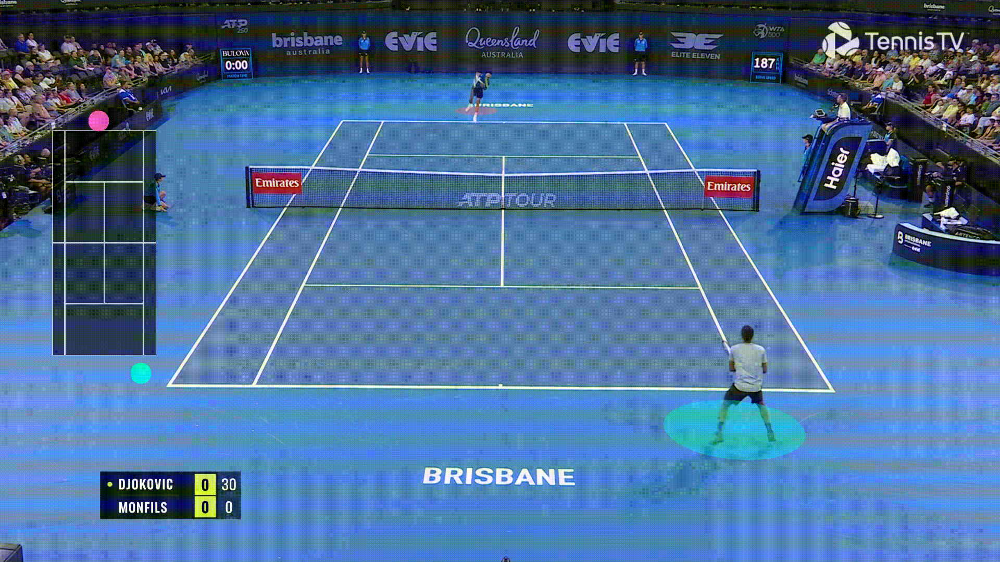
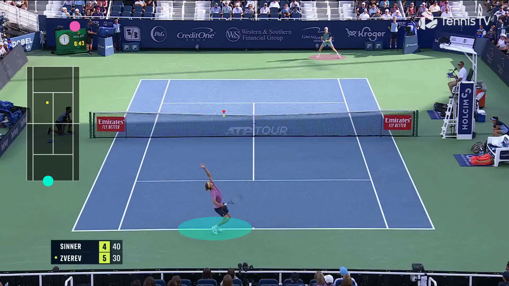

# Tennis Analytics System

A computer vision system for real-time tennis player and ball tracking using a transformer (RT-DETRv2) for object detection and keypoint detection.

> See [`SETUP_REPORT.md`](SETUP_REPORT.md) for the verified WSL setup, model
> conversion details, and benchmark results. See
> [`OMARCHY_SETUP.md`](OMARCHY_SETUP.md) for exporting to full Linux
> (Omarchy/Arch) and resuming work in a new OpenCode session.


## Overview
This system analyzes tennis video streams in real-time to:
- Detect and track tennis players and ball
- Project detections onto a 2D tennis court visualization (minimap)
- Track player positions and movements
- Track ball trajectory with interpolation between detections

It uses separate threads for decoding frames from the stream and for processing the frames. The frame-decoding thread dynamically skips frames based on the speed of the processing thread. This enables real-time analysis even if the processing is slower than real-time (obviously, this only makes sense for applications where it's not critical that every frame be processed). With an NVIDIA GeForce GTX 1650 Ti, [RT-DETRv2-M*](https://github.com/lyuwenyu/RT-DETR/tree/main/rtdetrv2_pytorch) and a frame resolution of 1920x1080, my frame-rate was about 15 FPS, 20 FPS for 1280x720 and 25 FPS for 640x480.

## Setup

### Prerequisites
- Python 3.10/3.11 (3.11 recommended; this is what the WSL setup below uses)
- NVIDIA driver + GPU. A system-wide CUDA toolkit / `nvcc` is **not** required;
  the PyTorch and TensorRT wheels bring their own CUDA runtime libraries.
- Required model weights (generated automatically by `tools/setup_models.py`):
  - RT-DETR object detection model as ONNX + TensorRT engine
  - Keypoint detection model as ONNX + TensorRT engine

### Installation (Linux / WSL)

```bash
conda create -n tennis python=3.11 -y
conda activate tennis

# CUDA 12.8 build; change cu128 if your driver needs another CUDA version
pip install torch==2.7.1 torchvision==0.22.1 \
    --index-url https://download.pytorch.org/whl/cu128

pip install -r requirements.txt
```

`requirements.txt` uses `opencv-python-headless`; on a desktop where you want
the `cv2.imshow` window, install `opencv-python` instead.

The old `requirements.txt` omitted `torchvision`, `PyYAML`, `onnx`, `tensorrt`
and PyCUDA. PyCUDA is no longer used: `utils/trt_prediction.py` now allocates
device memory and streams with PyTorch, so no CUDA headers/compiler are needed.

Use a TensorRT CUDA-12 build that matches the PyTorch wheel.  On this setup
(CUDA 12.8) that is:

```bash
pip install tensorrt==10.8.0.43
# or equivalently: pip install tensorrt-cu12==10.8.0.43
```

Do not blindly install the newest `tensorrt` meta-package: 10.13+ defaults to
the CUDA 13 (`tensorrt-cu13`) wheels.

### Model Preparation (automatic)

`tools/setup_models.py` downloads the weights, validates that nothing is an HTML
error page, exports ONNX, and builds TensorRT engines using the Python API
(no `trtexec` binary required):

```bash
# RT-DETRv2-L (r50) detector + tennis court keypoint detector
python tools/setup_models.py --all

# Or pick a smaller/faster detector: r18, r34, r50, r101
python tools/setup_models.py --all --rtdetr-model r18

# Only download weights / only rebuild engines
python tools/setup_models.py --download-only
python tools/setup_models.py --component keypoint --skip-onnx
```

The script writes `models/models.json` with sizes, hashes and input/output
shapes. The previous `../RT-DETR/models/*.yml` files in this checkout are saved
GitHub HTML pages, not YAML; the script always uses the real configs from the
RT-DETR repository (cloning it into `../RT-DETR` if necessary).

Manual alternative: the upstream RT-DETR export script lives at
`../RT-DETR/rtdetrv2_pytorch/tools/export_onnx.py`. Note that the copy at
`tools/export_onnx.py` in this repository is an HTML page, not Python code.

### Model Training for Keypoint Detection Model
1. Download training data from [here](https://github.com/yastrebksv/TennisCourtDetector?tab=readme-ov-file)
2. Use training/keypoint_training.py to train
3. Convert to .onnx using training/keypoint_to_onnx.py
4. Convert to .trt using `tools/setup_models.py --component keypoint --skip-onnx` (or `trtexec`)

## Usage

### Training

### Running the System
1. Start a video stream, e.g. with:
```bash
python streaming/start_mjpeg_stream.py [path/to/video.mp4]
```

2. Start the main tracking system:
```bash
python main.py
```

On a headless Linux/WSL machine (no X server), disable the GUI and/or process a
local file directly:
```bash
# local video file, write output.mp4, no window
python main.py --stream_url videos/sample_tennis.mp4 --no-display

# stop after 100 frames
python main.py --stream_url videos/sample_tennis.mp4 --no-display --max-frames 100

# quick model smoke test on one frame (prints detections + keypoints)
python tools/verify_models.py --video videos/sample_tennis.mp4 --save preview.jpg
```

`main.py` now sizes the output video from the input frame and accepts
`--output`, `--output_fps`, `--no-display`, `--max-frames` and
`--minimap-width`.  A local video file is consumed through a small bounded
queue, so every frame is processed; a network stream keeps the original
real-time frame-skipping behaviour.

### Court keypoint overlay (debugging)

Annotated videos draw the 14 court/terrain keypoints, the inferred court
skeleton and a court-fit status line by default:

- green numbered points: outer court corners/lines (0–3)
- orange numbered points: singles sidelines (4–7)
- magenta numbered points: service lines / centre service line (8–13)
- yellow lines: inferred court skeleton
- bottom-left status: `court keypoints: OK` or `court keypoints: FIT FAILED`

```bash
--no-keypoints       # disable keypoints, skeleton and status
--no-court-lines     # numbered points only
--no-court-status    # hide the OK/FAILED text
```

This makes a bad court fit immediately visible when reviewing an output video.
A single-frame preview is also available:

```bash
python tools/verify_models.py --video videos/sample_tennis.mp4 \
  --frame 0 --save /tmp/keypoints.jpg
```

## Components

### Perception
- Object detection using [RT-DETRv2](https://github.com/lyuwenyu/RT-DETR/tree/main)
- Keypoint detection for player pose estimation
- Custom TensorRT inference (verified with TensorRT 10.8.0.43) to speed up inference

### Minimap
- 2D tennis court visualization
- Projection of player and ball positions using homography
- Ball tracking with simple kinematic prediction model


## To make it better


- Fine-tune object detection model to detect only players and balls
- Improve prediction of ball position when ball is not detected (e.g. Kalman filter)
- Estimate height of ball for more accurate projection on minimap
- Train a better keypoint detection model for mor accurate minimap
- Calculate player and game statistics based on detections prespective transformation
- use c++ instead of python to make it faster, because pre- and post-processing is costly and python overhead is rather slow

